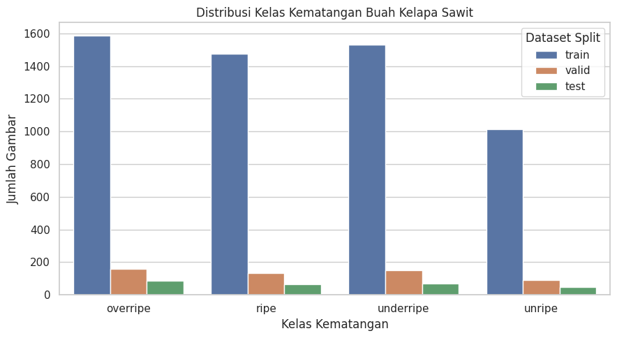
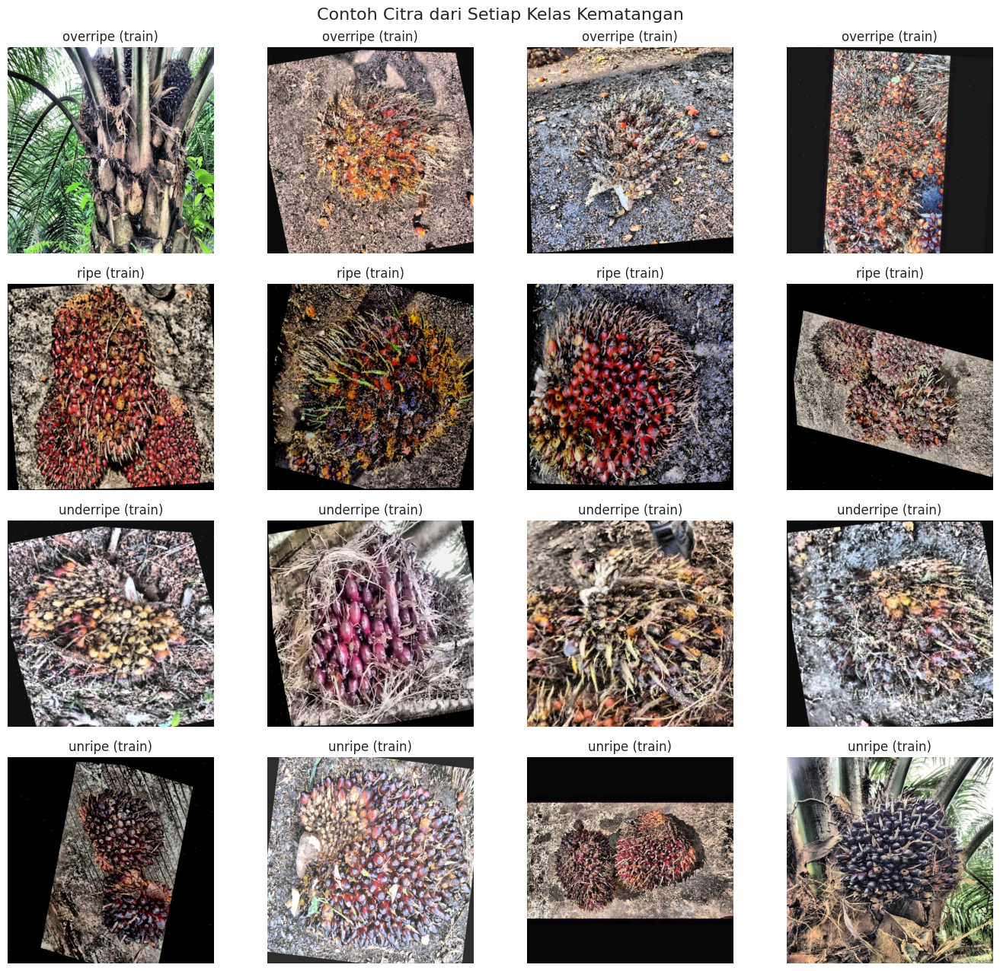
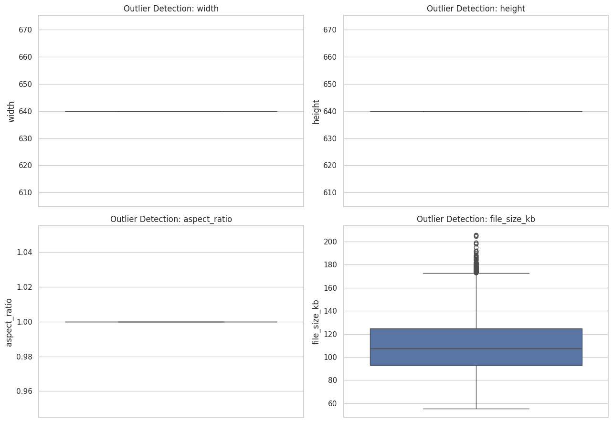

## INFORMASI PROYEK

**Judul Proyek:**  
Deteksi Kualitas Kematangan Buah Kelapa Sawit Berbasis Visi Komputer untuk Petani Swadaya

**Nama Mahasiswa:**

1. Mohammad Dani Taufiqurrohman
2. Raditya Alfareza Purnama Putra

**NIM:**

1. 244311048
2. 244311054

- **Program Studi:** Rekayasa Perangkat Lunak
- **Mata Kuliah:** Datascience
- **Dosen Pengampu:** [Nama Dosen]
- **Tahun Akademik:** 2026/5
- **Link GitHub Repository:** https://github.com/Danipinion/Kelompok-11-UAS-DS
- **Link Video Pembahasan:** [URL Video (YouTube/Drive)]
- **SDG yang Dipilih:** SDG 8 – Pekerjaan Layak dan Pertumbuhan Ekonomi
- **Target SDG yang Relevan:** Target 8.2 – mencapai tingkat produktivitas ekonomi yang lebih tinggi melalui diversifikasi, peningkatan teknologi, dan inovasi; serta Target 8.3 – mendukung kegiatan produktif dan pertumbuhan usaha mikro, kecil, dan menengah

## 0. KERANGKA ML LIFECYCLE (L-M-O-P)

Laporan ini disusun mengikuti **ML Lifecycle** yang terdiri dari empat tahap berulang (iteratif):

| Tahap                  | Singkatan | Inti Pertanyaan                                                               | Bagian Laporan        |
| ---------------------- | --------- | ----------------------------------------------------------------------------- | --------------------- |
| **Learning Problem**   | **L**     | Apa target, objective, dan datanya?                                           | Bab 2, 3, 4, 5        |
| **Model Design**       | **M**     | Model family/arsitektur apa, hypothesis space, dan inductive bias/asumsi apa? | Bab 6 (6.x.1 – 6.x.3) |
| **Optimization**       | **O**     | Bagaimana model dilatih: loss, optimizer, tuning, regularisasi, konvergensi?  | Bab 6 (6.x.4 – 6.x.6) |
| **Predict & Evaluate** | **P**     | Seberapa baik prediksi model berdasarkan metrik evaluasi?                     | Bab 7                 |

```
   L (Learning Problem) ──► M (Model Design) ──► O (Optimization) ──► P (Predict & Evaluate)
          ▲                                                                   │
          └─────────────── iterasi / perbaikan berdasarkan hasil evaluasi ────┘
```

**Catatan untuk mahasiswa:** Setiap bagian diberi label **[L]**, **[M]**, **[O]**, atau **[P]**. Pastikan Anda dapat menjelaskan keterkaitan antar tahap, misalnya bagaimana hasil **P** mendorong perbaikan pada **L/M/O** (Bab 7.5).

---

## 1. LEARNING OUTCOMES

Pada proyek ini, mahasiswa diharapkan dapat:

1. **[L]** Mengidentifikasi masalah nyata dari **ide sendiri** yang selaras dengan salah satu tujuan **SDGs** ([Agenda 2030 – sdgs.un.org/2030agenda](https://sdgs.un.org/2030agenda)), lalu merumuskan problem statement (target, objective, data) secara jelas
2. **[L]** Melakukan analisis dan eksplorasi data (EDA) secara komprehensif (**OPSIONAL**)
3. **[L]** Melakukan data preparation yang sesuai dengan karakteristik dataset
4. **[M]** Merancang tiga model machine learning dengan justifikasi hypothesis space dan inductive bias (**WAJIB**):
   - Model baseline
   - Model machine learning / advanced
   - Model deep learning (**WAJIB**)
5. **[O]** Mengoptimasi model secara sistematis (loss function, optimizer, hyperparameter tuning, regularisasi)
6. **[P]** Menggunakan metrik evaluasi yang relevan dengan jenis tugas ML dan menganalisis hasilnya
7. Melaporkan hasil eksperimen secara ilmiah dan sistematis
8. Mengunggah seluruh kode proyek ke GitHub (**WAJIB**)
9. Menerapkan prinsip software engineering dalam pengembangan proyek

---

## 2. PROJECT OVERVIEW **[L]**

### 2.1 Latar Belakang

Kelapa sawit merupakan salah satu komoditas perkebunan utama di Indonesia, dan sebagian besar pekebun swadaya menggantungkan penghasilannya pada penjualan Tandan Buah Segar (TBS). Harga TBS sangat dipengaruhi oleh tingkat kematangan buah saat disortir di pabrik atau oleh tengkulak. Penilaian kematangan secara manual bersifat subjektif sehingga sering terjadi penyortiran sepihak: TBS yang sebenarnya sudah matang dikategorikan mengkal atau mentah, lalu dihargai lebih murah. Akibatnya petani swadaya berada pada posisi tawar yang lemah dan berpotensi mengalami kerugian pendapatan.

Pendekatan visi komputer (_computer vision_) memungkinkan penilaian kematangan dilakukan secara objektif dan konsisten berdasarkan citra buah. Model klasifikasi citra yang ringan dan tahan terhadap variasi pencahayaan kebun dapat menjadi alat bantu bagi petani untuk memverifikasi kualitas TBS sebelum dijual, dan di masa depan dapat diimplementasikan pada aplikasi mobile Android. Manfaat utamanya adalah memberi petani bukti penilaian yang objektif sehingga memiliki daya tawar yang lebih adil atas hasil panennya.

Studi terdahulu menunjukkan bahwa pendekatan _deep learning_ efektif untuk mengklasifikasikan tingkat kematangan TBS kelapa sawit (Zulkarnain et al., 2024). Proyek ini membandingkan tiga pendekatan, yaitu SVM berbasis fitur warna/tekstur, Random Forest, dan CNN dengan _transfer learning_ (MobileNetV2).

**Referensi:**

> Zulkarnain, J., Kusrini, & Hidayat, T. (2024). Klasifikasi tingkat kematangan tandan buah segar kelapa sawit menggunakan pendekatan deep learning. _JST (Jurnal Sains Dan Teknologi), 12_(3). https://doi.org/10.23887/jstundiksha.v12i3.59140

> United Nations. _Goal 8: Promote sustained, inclusive and sustainable economic growth, full and productive employment and decent work for all_. https://sdgs.un.org/goals/goal8

### 2.2 Keterkaitan dengan SDGs (WAJIB)

| Komponen                 | Pertanyaan Panduan                                                             | Jawaban Anda                                                                                                                                                                                                                                                                                                        |
| ------------------------ | ------------------------------------------------------------------------------ | ------------------------------------------------------------------------------------------------------------------------------------------------------------------------------------------------------------------------------------------------------------------------------------------------------------------- |
| **SDG yang dipilih**     | Goal nomor berapa dan apa namanya?                                             | SDG 8 – Pekerjaan Layak dan Pertumbuhan Ekonomi                                                                                                                                                                                                                                                                     |
| **Target SDG**           | Target (misal 3.4, 13.1) mana yang paling relevan?                             | Target 8.2 (produktivitas ekonomi melalui peningkatan teknologi dan inovasi) dan Target 8.3 (mendukung kegiatan produktif serta pertumbuhan usaha mikro, kecil, dan menengah)                                                                                                                                       |
| **Masalah nyata**        | Masalah konkret apa yang diangkat? Siapa yang terdampak?                       | Penilaian kematangan TBS secara manual bersifat subjektif sehingga petani kelapa sawit swadaya dirugikan oleh penyortiran sepihak dari pabrik atau tengkulak. Buah yang sebenarnya matang sering dikategorikan mengkal atau mentah dan dihargai murah.                                                              |
| **Peran ML**             | Mengapa ML/DL cocok? Apa keputusan atau proses yang dibantu?                   | Klasifikasi citra multikelas dengan ML/DL memberi penilaian kematangan yang objektif dan konsisten dari foto buah. Proses yang dibantu adalah penentuan kelas kematangan TBS sebagai dasar negosiasi harga jual.                                                                                                    |
| **Indikator kontribusi** | Bagaimana hasil model berkontribusi pada target SDG (langsung/tidak langsung)? | Tidak langsung: penilaian yang objektif membantu petani memperoleh harga yang lebih adil sehingga pendapatan usaha taninya lebih terjaga. Model yang ringan dan siap dipasang di ponsel menunjukkan peran inovasi teknologi bagi usaha kecil.                                                                       |
| **Pertimbangan etika**   | Risiko bias, privasi, atau dampak salah prediksi?                              | Risiko bias lingkungan: model dapat salah prediksi pada gambar _backlight_, mendung, atau tertutup bayangan pelepah. Dari sisi privasi aman karena data tidak memuat wajah manusia atau data sensitif. Transparansi model harus dijaga agar tidak disalahgunakan pihak pabrik untuk menekan harga beli dari petani. |

**Sumber ide:** Ide berasal dari isu penyortiran sepihak TBS yang dialami petani kelapa sawit swadaya, yaitu penilaian kematangan yang subjektif sehingga merugikan petani dan melemahkan daya tawar mereka.

### 2.3 Ringkasan Alur Lifecycle Proyek

Pada tahap **L**, masalah dirumuskan sebagai klasifikasi citra multikelas (4 kelas kematangan) dengan dataset _Outdoor Oil Palm Fruit Ripeness_ dari Kaggle, lalu data dipersiapkan (pembersihan, _resizing_, augmentasi, dan _splitting_ tanpa kebocoran data). Pada tahap **M**, dirancang tiga model: SVM dengan fitur warna HSV/tekstur GLCM sebagai baseline, Random Forest dengan fitur warna, tekstur, dan bentuk sebagai model advanced, serta CNN _transfer learning_ MobileNetV2 sebagai model deep learning. Pada tahap **O**, model dilatih dan dioptimasi (tuning hyperparameter, regularisasi, pengaturan learning rate dan batch size). Pada tahap **P**, ketiga model dievaluasi pada test set dengan Macro F1-Score, Accuracy, Precision, dan Recall, disertai analisis kesalahan (misalnya pada kondisi pencahayaan sulit). Hasil evaluasi digunakan untuk satu iterasi perbaikan pada tahap L/M/O.

---

## 3. BUSINESS UNDERSTANDING / PROBLEM UNDERSTANDING **[L]**

### 3.1 Problem Statements

1. Penilaian kematangan TBS secara manual bersifat subjektif sehingga petani swadaya berpotensi dirugikan oleh penyortiran sepihak dan harga jual yang rendah.
2. Sistem harus dapat mengenali empat kelas kematangan buah kelapa sawit (Unripe, Underripe, Ripe, dan Overripe) secara otomatis berdasarkan citra RGB.
3. Citra memiliki variasi kondisi visual, sehingga diperlukan preprocessing dan augmentasi untuk meningkatkan kemampuan model dalam mengenali kematangan buah pada berbagai kondisi.
4. Dataset memiliki jumlah dan distribusi kelas yang perlu diperhatikan, sehingga dibutuhkan model deep learning ringan berbasis transfer learning serta metrik evaluasi yang sesuai.

### 3.2 Formulasi Learning Problem (WAJIB)

| Komponen      | Pertanyaan Panduan                                                                                          | Jawaban Anda                                                                                                                                                                                                                                                                                                                                                                                                                                                                                                                                                                                                                                                                                                                        |
| ------------- | ----------------------------------------------------------------------------------------------------------- | ----------------------------------------------------------------------------------------------------------------------------------------------------------------------------------------------------------------------------------------------------------------------------------------------------------------------------------------------------------------------------------------------------------------------------------------------------------------------------------------------------------------------------------------------------------------------------------------------------------------------------------------------------------------------------------------------------------------------------------- |
| **Target**    | Apa yang diprediksi? Jenis tugas (klasifikasi biner/multikelas, regresi, forecasting, clustering, dll.)?    | Kelas kematangan buah kelapa sawit (4 kelas: Unripe, Underripe, Ripe, dan Overripe). Jenis tugas: _image classification_ multikelas (_computer vision_).                                                                                                                                                                                                                                                                                                                                                                                                                                                                                                                                                                            |
| **Objective** | Apa yang dioptimalkan/diminimalkan secara matematis (misal: cross-entropy, MSE)? Metrik keberhasilan utama? | Meminimalkan _categorical cross-entropy_ pada model deep learning (dan fungsi loss yang sesuai pada SVM dan Random Forest). Metrik utama: **Macro F1-Score** untuk memperhatikan performa setiap kelas, dengan metrik pendukung Accuracy, Precision, dan Recall.                                                                                                                                                                                                                                                                                                                                                                                                                                                                    |
| **Data**      | Sumber, ukuran, jenis, dan asumsi tentang data (i.i.d.? distribusi train vs test?)                          | Sumber: [Oil Palm FFB Ripeness Dataset (Roboflow Universe)](https://universe.roboflow.com/fyp-oil-palm-fruit-ripeness-dataset/oil-palm-ffb-ripeness), t. Jenis: citra RGB. Ukuran: **6.412 citra**, terdiri dari 5.610 citra training, 535 citra validation, dan 267 citra testing. Preprocessing: Auto-Orient, resize _stretch_ ke 640×640 piksel, dan _adaptive equalization_ untuk penyesuaian kontras. Augmentasi: menghasilkan 3 variasi per citra training melalui flipping, rotasi, shear, penyesuaian hue, saturation, brightness, exposure, blur, dan noise. Asumsi: data antarpartisi dianggap mewakili distribusi yang sama, dengan evaluasi tetap memperhatikan potensi kemiripan citra agar tidak terjadi _data leakage_. |

### 3.3 Goals

1. Membangun model klasifikasi citra yang dapat mengenali 4 fase kematangan buah kelapa sawit secara objektif dengan Macro F1-Score ≥ 0,80 (target awal, dapat disesuaikan setelah EDA).
2. Mengukur dan membandingkan performa tiga pendekatan model: SVM (baseline), Random Forest (advanced), dan CNN MobileNetV2 (deep learning).
3. Menentukan model terbaik berdasarkan Macro F1-Score, Accuracy, Precision, dan Recall, serta menganalisis ketahanan model terhadap variasi pencahayaan kebun.
4. Menghasilkan sistem yang _reproducible_ dan ringan sehingga siap dikembangkan menjadi aplikasi mobile bagi petani.
5. **Kontribusi SDG 8:** menyediakan alat bantu penilaian kematangan TBS yang objektif agar petani swadaya memiliki daya tawar yang lebih adil sehingga mendukung produktivitas dan pendapatan usaha taninya (Target 8.2 dan 8.3).

### 3.4 Solution Approach **[M]**

#### **Model 1 – Baseline Model**

**Support Vector Machine (SVM)** dengan ekstraksi fitur manual berupa warna (histogram HSV) dan/atau tekstur (GLCM). SVM dipilih sebagai pembanding dasar karena sederhana, efektif pada data berdimensi menengah dengan sampel terbatas, dan fitur warna HSV relevan karena kematangan sawit tampak dari perubahan warna buah.

#### **Model 2 – Advanced / ML Model**

**Random Forest Classifier** dengan kombinasi fitur bentuk, warna, dan tekstur. Model _ensemble_ ini dipilih karena mampu menangkap hubungan non-linear antar fitur, relatif tahan terhadap _overfitting_, serta dapat menunjukkan _feature importance_ untuk melihat fitur mana yang paling berpengaruh pada kematangan.

#### **Model 3 – Deep Learning Model (WAJIB)**

**CNN dengan Transfer Learning MobileNetV2** (jenis data: citra). MobileNetV2 dipilih karena sangat ringan, cepat dilatih di Google Colab, dan siap diimplementasikan ke aplikasi mobile Android di masa depan. Model memanfaatkan bobot _pre-trained_ sehingga cocok untuk dataset yang berukuran terbatas, dilatih minimal 10 epoch dengan plot loss dan metrik per epoch serta evaluasi pada test set.

---

## 4. DATA UNDERSTANDING

### 4.1 Informasi Dataset

**Sumber Dataset:**  
[Oil Palm FFB Ripeness Dataset - Roboflow Universe].
https://www.kaggle.com/datasets/ramadanizikri112/ripeness-of-oil-palm-fruit

**Deskripsi Dataset:**

- Jumlah baris (rows): 6.412 data gambar.
- Jumlah kolom (columns/features): 5 kolom pada file CSV.
- Tipe data: Image (RGB) dengan label kategorikal.
- Ukuran dataset: 695.08 MB.
- Format file: jpg untuk citra dan CSV untuk anotasi label.

Dataset terdiri dari empat kelas kematangan buah kelapa sawit, yaitu Overripe, Ripe, Underripe, dan Unripe. Dataset dibagi menjadi tiga partisi:

| Partisi    | Jumlah Gambar |
| ---------- | ------------: |
| Training   |         5.610 |
| Validation |           535 |
| Testing    |           267 |
| **Total**  |     **6.412** |

### 4.2 Deskripsi Fitur

Dataset menggunakan file CSV pada setiap partisi untuk menghubungkan nama gambar dengan label kelas menggunakan format One-Hot Encoding.

| Nama Fitur | Tipe Data | Deskripsi                    | Contoh Nilai |
| ---------- | --------- | ---------------------------- | ------------ |
| filename   | String    | Nama file citra kelapa sawit | ripe-316.jpg |
| overripe   | Binary    | Indikator kelas lewat matang | 0 atau 1     |
| ripe       | Binary    | Indikator kelas matang       | 0 atau 1     |
| underripe  | Binary    | Indikator kelas mengkal      | 0 atau 1     |
| unripe     | Binary    | Indikator kelas mentah       | 0 atau 1     |

Setiap gambar seharusnya memiliki tepat satu label aktif bernilai 1, sedangkan tiga label lainnya bernilai 0. Citra RGB digunakan sebagai input untuk proses klasifikasi.

### 4.3 Kondisi Data

- **Missing Values:** Seluruh 6.412 nama file pada CSV berhasil dicocokkan dengan gambar yang tersedia.
- **Duplicate Data:** Tidak ditemukan duplikasi gambar berdasarkan pemeriksaan SHA-256. Dari total 6.412 gambar, seluruhnya memiliki hash unik, sehingga tidak ditemukan gambar duplikat maupun duplikasi antarpartisi training, validation, dan testing.
- **Outliers:** Ditemukan 114 gambar (1,78%) yang terindikasi sebagai outlier berdasarkan ukuran file (`file_size_kb`) menggunakan metode Interquartile Range (IQR). Tidak ditemukan outlier pada resolusi gambar (`width` dan `height`) maupun rasio aspek (`aspect_ratio`). Gambar yang terindikasi outlier belum tentu merupakan data yang tidak valid sehingga perlu pemeriksaan visual lebih lanjut sebelum dilakukan penanganan.
- **Imbalanced Data:** Terdapat indikasi ketidakseimbangan kelas dengan distribusi awal:

  | Kelas     | Jumlah Gambar | Persentase |
  | --------- | ------------: | ---------: |
  | Overripe  |         1.831 |     28,56% |
  | Ripe      |         1.676 |     26,14% |
  | Underripe |         1.751 |     27,31% |
  | Unripe    |         1.154 |     18,00% |
  | **Total** |     **6.412** |   **100%** |

  Imbalance ratio sebesar 1,59, dihitung dari jumlah kelas terbanyak dibandingkan kelas paling sedikit.

- **Noise:** Belum diperiksa secara menyeluruh. Variasi pencahayaan, bayangan, dan kondisi visual citra menjadi aspek yang perlu dievaluasi.
- **Data Quality Issues:** Ditemukan 622 data (9,70%) dengan format label yang tidak sesuai One-Hot Encoding. Sebanyak 5.790 data (90,30%) memiliki tepat satu label aktif, sedangkan 622 data terdiri dari label kosong (seluruh nilai 0) atau multi-label (lebih dari satu nilai 1). Seluruh 6.412 gambar berhasil ditemukan dan tidak terdapat gambar tanpa pasangan CSV.
- **Asumsi Data (i.i.d., distribusi train-test, potensi data leakage):** Dataset dibagi menjadi training, validation, dan testing dengan proporsi masing-masing sekitar 87,49%, 8,34%, dan 4,16%. Data diasumsikan berasal dari distribusi yang serupa, tetapi kemiripan gambar antarpartisi masih perlu diperiksa untuk menghindari data leakage.

### 4.4 Exploratory Data Analysis (EDA) - (**OPSIONAL**)

#### Visualisasi 1: Distribusi Kelas Kematangan Buah Kelapa Sawit



**Insight:**
Visualisasi menunjukkan distribusi jumlah gambar pada empat kelas kematangan, yaitu Overripe, Ripe, Underripe, dan Unripe, berdasarkan partisi training, validation, dan testing. Distribusi ini digunakan untuk mengetahui kelas dominan dan kelas minoritas serta mengevaluasi potensi ketidakseimbangan data yang dapat memengaruhi proses pelatihan model.

#### Visualisasi 2: Sampel Citra Setiap Kelas Kematangan



**Insight:**
Visualisasi menampilkan contoh citra dari masing-masing kelas kematangan buah kelapa sawit. Perbedaan dan kemiripan karakteristik visual antar kelas dapat diamati untuk memahami tantangan klasifikasi. Selain itu, variasi pencahayaan, bayangan, latar belakang, dan sudut pengambilan gambar menjadi faktor yang perlu diperhatikan dalam pengembangan model.

#### Visualisasi 3: Distribusi Ukuran File dan Deteksi Outliers



**Insight:**
Visualisasi menunjukkan persebaran ukuran file citra berdasarkan metode Interquartile Range (IQR). Ditemukan 114 gambar atau sekitar 1,78% dari keseluruhan dataset yang terindikasi sebagai outlier berdasarkan ukuran file. Nilai ekstrem tersebut menunjukkan adanya variasi ukuran penyimpanan gambar, tetapi tidak secara langsung menandakan kerusakan citra sehingga tidak menjadi dasar penghapusan data.

---

## 5. DATA PREPARATION **[L]**

Bagian ini menjelaskan **semua** proses transformasi dan preprocessing data yang dilakukan.

### 5.1 Data Cleaning

Data cleaning dilakukan untuk memastikan gambar dan label memiliki kualitas yang sesuai.

- **Missing values:** Tidak ditemukan gambar yang hilang. Seluruh 6.412 anotasi memiliki file gambar yang tersedia dan dapat dibaca.
- **Validasi label:** Ditemukan 5.790 label valid dengan format One-Hot Encoding dan 622 label tidak valid, yaitu label kosong atau memiliki lebih dari satu kelas aktif.
- **Penanganan label:** Sebanyak 622 data dengan label tidak valid dikeluarkan karena tidak dapat digunakan sebagai target klasifikasi yang pasti.
- **Duplicates:** Pemeriksaan menggunakan SHA-256 dilakukan untuk mendeteksi gambar yang identik.
- **Outliers:** Outlier ukuran file diperiksa menggunakan metode Interquartile Range (IQR). Data tidak langsung dihapus karena perbedaan ukuran file belum tentu menunjukkan gambar yang rusak.
- **Data type conversion:** Kolom label dikonversi menjadi tipe numerik untuk memudahkan proses pengolahan.

Hasilnya, dataset berkurang dari 6.412 menjadi **5.790 gambar bersih**.

### 5.2 Feature Engineering

Feature engineering dilakukan dengan mengekstraksi informasi dasar dari setiap gambar, yaitu:

- Lebar dan tinggi gambar.
- Aspect ratio atau perbandingan lebar dan tinggi.
- Rata-rata nilai kanal warna Red, Green, dan Blue (RGB).

Fitur tersebut digunakan untuk membantu pemeriksaan karakteristik gambar. Fitur utama yang digunakan untuk klasifikasi tetap berupa piksel citra RGB, sehingga model CNN dapat mempelajari pola visual secara otomatis.

### 5.3 Data Transformation

Transformasi dilakukan agar gambar memiliki format yang seragam dan dapat diproses oleh model.

- **Color space conversion:** Seluruh gambar dikonversi ke format RGB.
- **Resizing:** Ukuran gambar diseragamkan menjadi 224 × 224 piksel.
- **Normalization:** Nilai piksel dinormalisasi dari rentang 0–255 menjadi 0–1.
- **Label encoding:** Empat kelas dikonversi menjadi angka, yaitu overripe (0), ripe (1), underripe (2), dan unripe (3).
- **Data augmentation:** Diterapkan pada data training menggunakan random flip, rotation, zoom, dan contrast untuk menambah variasi gambar.

Augmentasi hanya diterapkan pada data training, sedangkan validation dan test tetap menggunakan gambar tanpa augmentasi.

### 5.4 Data Splitting

Pembagian dataset menggunakan training, validation, dan test. Pembagian ini dipertahankan agar tidak mengubah struktur dataset yang tersedia.

Setelah proses cleaning, pembagian data menjadi:

- **Training set:** 5.074 gambar (87,63%).
- **Validation set:** 474 gambar (8,19%).
- **Test set:** 242 gambar (4,18%).

Data training digunakan untuk melatih model, validation digunakan untuk memantau performa dan melakukan tuning, sedangkan test digunakan untuk evaluasi akhir model.

### 5.5 Data Balancing

Penanganan ketidakseimbangan kelas dilakukan menggunakan metode **Class Weights**. Bobot setiap kelas dihitung berdasarkan jumlah data pada training set.

Metode ini dipilih karena dapat memberikan perhatian lebih besar kepada kelas dengan jumlah sampel lebih sedikit tanpa menambah atau mengurangi jumlah gambar. Perhitungan bobot hanya menggunakan data training untuk menghindari data leakage.

### 5.6 Ringkasan Data Preparation

1. **Apa yang dilakukan?**

   Membersihkan label yang tidak valid, memeriksa file gambar dan duplikasi, mengekstraksi fitur dasar, melakukan transformasi citra, serta menyiapkan pembagian data dan class weights.

2. **Mengapa penting?**

   Agar data yang digunakan memiliki label yang valid, format gambar seragam, dan siap diproses oleh model. Tahapan ini juga membantu mengurangi risiko kesalahan pelatihan dan data leakage.

3. **Bagaimana implementasinya?**

   Proses dilakukan menggunakan Python, Pandas, Pillow, TensorFlow, dan Scikit-learn melalui Google Colab. Hasil akhir berupa 5.790 gambar yang terdiri dari 5.074 data training, 474 validation, dan 242 test.

---

## 6. MODELING [M + O]

### 6.1 Model 1 — Baseline Model

#### 6.1.1 Deskripsi Model [M]

**Nama Model:** Support Vector Machine (SVM) dengan kernel Radial Basis Function (RBF).

**Teori Singkat:**

Support Vector Machine (SVM) merupakan algoritma *supervised learning* yang digunakan untuk melakukan klasifikasi dengan mencari batas keputusan (*hyperplane*) terbaik yang memisahkan data dari kelas yang berbeda. SVM berusaha memaksimalkan jarak atau *margin* antara hyperplane dengan sampel terdekat dari masing-masing kelas sehingga dapat menghasilkan pemisahan kelas yang optimal.

Pada penelitian ini, SVM menggunakan kernel Radial Basis Function (RBF) untuk mempelajari hubungan non-linear antara fitur visual dan tingkat kematangan tandan buah segar kelapa sawit. Sebelum proses klasifikasi, citra diubah menjadi fitur numerik melalui ekstraksi histogram warna HSV dan tekstur Gray-Level Co-occurrence Matrix (GLCM).

**Alasan Pemilihan:**

SVM dipilih sebagai model baseline karena mampu bekerja dengan baik pada dataset berukuran terbatas dan fitur berdimensi menengah. Pemilihan fitur histogram HSV didasarkan pada karakteristik perubahan warna buah kelapa sawit selama proses pematangan. Sementara itu, fitur GLCM digunakan untuk merepresentasikan karakteristik tekstur permukaan buah.

Kombinasi fitur tersebut diharapkan dapat memberikan informasi yang cukup untuk membedakan empat tingkat kematangan, yaitu *overripe*, *ripe*, *underripe*, dan *unripe*. Selain itu, penggunaan kernel RBF memungkinkan model mempelajari pola hubungan non-linear yang mungkin tidak dapat dipisahkan menggunakan batas keputusan linear.

#### 6.1.2 Hypothesis Space & Inductive Bias [M]

- **Model family / arsitektur:**

  Kernel-based Support Vector Classifier dengan kernel Radial Basis Function (RBF).

- **Hypothesis space:**

  Himpunan fungsi keputusan yang dapat dibentuk melalui kombinasi kernel RBF pada ruang fitur hasil transformasi. Model dapat membentuk batas keputusan non-linear untuk memisahkan empat kelas tingkat kematangan buah kelapa sawit.

- **Inductive bias / asumsi:**

  SVM memiliki asumsi bahwa pemisahan kelas yang baik dapat diperoleh dengan mencari batas keputusan yang memaksimalkan margin pada ruang fitur. Penggunaan kernel RBF memungkinkan model mempelajari hubungan non-linear antarfitur tanpa harus melakukan transformasi fitur secara eksplisit.

- **Implikasi terhadap dataset:**

  Asumsi tersebut relevan dengan karakteristik dataset karena perbedaan tingkat kematangan buah kelapa sawit tidak hanya ditentukan oleh satu karakteristik warna, tetapi juga dapat dipengaruhi oleh kombinasi warna dan tekstur. Oleh karena itu, penggunaan kernel RBF diharapkan mampu menangkap pola pemisahan antar kelas yang lebih kompleks.

  Namun, performa SVM tetap bergantung pada kualitas fitur hasil ekstraksi manual. Informasi visual yang tidak direpresentasikan oleh histogram HSV dan GLCM tidak dapat dipelajari secara langsung oleh model.

#### 6.1.3 Implementasi (Ringkas) [M]

Implementasi model dilakukan menggunakan Python dan Scikit-learn melalui Google Colab. Dataset yang digunakan merupakan hasil proses *data preparation* pada Bab 5, dengan total 5.790 gambar yang terdiri dari 5.074 data training, 474 data validation, dan 242 data testing.

Sebelum proses klasifikasi, setiap citra diubah menjadi 80 fitur numerik yang terdiri dari:

1. **Histogram HSV (32 fitur):** Mengekstraksi distribusi warna pada kanal Hue, Saturation, dan Value.
2. **GLCM (48 fitur):** Mengekstraksi karakteristik tekstur berdasarkan contrast, dissimilarity, homogeneity, energy, correlation, dan ASM pada beberapa jarak dan arah.

Citra diubah ukurannya menjadi 128 × 128 piksel untuk proses ekstraksi fitur. Selanjutnya, seluruh fitur digabungkan menjadi *feature matrix* yang digunakan sebagai masukan model SVM.

Standardisasi fitur dilakukan menggunakan `StandardScaler` yang ditempatkan dalam `Pipeline`. Dengan demikian, proses standardisasi hanya mempelajari karakteristik data training dan diterapkan pada validation maupun test tanpa melakukan proses *fit* ulang.

Implementasi model:

```python
from sklearn.svm import SVC
from sklearn.pipeline import Pipeline
from sklearn.preprocessing import StandardScaler

model_svm = Pipeline([
    ("scaler", StandardScaler()),
    ("classifier", SVC(
        kernel="rbf",
        C=1.0,
        gamma="scale",
        class_weight="balanced",
        random_state=42
    ))
])

model_svm.fit(X_train, y_train)

y_valid_pred = model_svm.predict(X_valid)
```

#### 6.1.4 Optimization: Objective, Hyperparameter & Regularisasi [O]

**Objective / loss yang dioptimalkan:**

SVM mengoptimalkan fungsi objektif yang menggabungkan regularisasi dan *hinge loss* untuk memperoleh batas keputusan dengan margin yang baik sekaligus meminimalkan kesalahan klasifikasi. Pada implementasi klasifikasi multi-kelas Scikit-learn, `SVC` menggunakan pendekatan *One-vs-One* untuk membentuk pemisah antar pasangan kelas.

**Parameter yang digunakan:**

| Parameter | Nilai | Keterangan |
|---|---|---|
| kernel | `rbf` | Menggunakan kernel non-linear |
| C | 1.0 | Mengatur penalti terhadap kesalahan klasifikasi |
| gamma | `scale` | Menentukan pengaruh setiap sampel dalam kernel RBF |
| class_weight | `balanced` | Menyesuaikan bobot berdasarkan distribusi kelas training |
| random_state | 42 | Menetapkan nilai random state |

**Regularisasi:**

Pengendalian kompleksitas model dilakukan melalui parameter `C` pada SVM. Nilai `C` mengatur keseimbangan antara margin yang lebih luas dan penalti terhadap kesalahan klasifikasi. Nilai `C` yang lebih besar memberikan penalti lebih tinggi terhadap kesalahan training, sedangkan nilai yang lebih kecil memberikan toleransi kesalahan yang lebih besar.

Pada eksperimen baseline ini digunakan nilai `C = 1.0` sebagai konfigurasi awal. Parameter tersebut belum melalui proses hyperparameter tuning dan akan menjadi acuan untuk eksperimen optimasi selanjutnya.

Standardisasi fitur menggunakan `StandardScaler` juga diterapkan agar perbedaan skala antarfitur tidak menyebabkan fitur tertentu mendominasi proses pembelajaran.

#### 6.1.5 Hasil Awal [O → P]

Evaluasi awal dilakukan menggunakan validation set yang terdiri dari 474 gambar. Data testing tidak digunakan pada tahap ini karena akan dipertahankan untuk evaluasi akhir seluruh model pada Bab 7.

**Hasil Evaluasi Validation Set:**

| Metrik | Hasil |
|---|---:|
| Accuracy | 75,95% |
| Precision Macro | 76,52% |
| Recall Macro | 76,44% |
| F1-Score Macro | 76,39% |
| F1-Score Weighted | 76,02% |
| Waktu Training | 2,30 detik |

Berdasarkan hasil tersebut, model SVM memperoleh accuracy sebesar 75,95%. Nilai precision macro sebesar 76,52%, recall macro sebesar 76,44%, dan F1-score macro sebesar 76,39%. Hasil ini menunjukkan bahwa model baseline mampu mengklasifikasikan sebagian besar citra dengan cukup baik serta memiliki performa yang relatif seimbang pada keempat kelas.

**Hasil Klasifikasi Setiap Kelas:**

| Kelas | Precision | Recall | F1-Score | Support |
|---|---:|---:|---:|---:|
| Overripe | 79% | 71% | 75% | 136 |
| Ripe | 66% | 73% | 69% | 128 |
| Underripe | 82% | 81% | 82% | 118 |
| Unripe | 79% | 80% | 80% | 92 |
| **Macro Average** | **77%** | **76%** | **76%** | **474** |
| **Weighted Average** | **76%** | **76%** | **76%** | **474** |

Berdasarkan hasil klasifikasi setiap kelas, model memperoleh performa terbaik pada kelas *underripe* dengan F1-score sebesar 82%. Sementara itu, kelas *ripe* memperoleh F1-score terendah sebesar 69%. Hal ini menunjukkan bahwa model masih mengalami kesulitan dalam membedakan karakteristik visual antara beberapa tingkat kematangan, khususnya kelas *ripe*.

**Analisis Confusion Matrix:**

Hasil confusion matrix menunjukkan bahwa sebagian besar prediksi benar berada pada diagonal utama. Rincian hasil klasifikasi adalah sebagai berikut:

| Kelas Aktual | Overripe | Ripe | Underripe | Unripe |
|---|---:|---:|---:|---:|
| Overripe | 97 | 34 | 1 | 4 |
| Ripe | 17 | 93 | 13 | 5 |
| Underripe | 4 | 7 | 96 | 11 |
| Unripe | 5 | 6 | 7 | 74 |

Pada kelas *overripe*, model berhasil mengklasifikasikan 97 dari 136 gambar dengan benar. Kesalahan terbesar terjadi ketika 34 gambar *overripe* diprediksi sebagai *ripe*. Hal ini menunjukkan adanya kemiripan karakteristik visual antara buah yang telah lewat matang dan buah yang matang.

Pada kelas *ripe*, sebanyak 93 dari 128 gambar berhasil diklasifikasikan dengan benar. Kesalahan prediksi paling banyak terjadi pada kelas *overripe* sebanyak 17 gambar dan *underripe* sebanyak 13 gambar. Kondisi ini menunjukkan bahwa kelas *ripe* masih memiliki karakteristik visual yang tumpang tindih dengan tingkat kematangan di sekitarnya.

Pada kelas *underripe*, model berhasil mengklasifikasikan 96 dari 118 gambar dengan benar. Kesalahan klasifikasi paling banyak terjadi pada kelas *unripe* sebanyak 11 gambar. Sementara itu, pada kelas *unripe*, sebanyak 74 dari 92 gambar berhasil diklasifikasikan dengan benar.

Secara keseluruhan, hasil tersebut menunjukkan bahwa SVM mampu mempelajari pola warna dan tekstur untuk membedakan tingkat kematangan buah kelapa sawit. Namun, kesalahan klasifikasi masih ditemukan pada kelas-kelas yang memiliki kemiripan visual, terutama antara *overripe* dan *ripe*.

**Kesimpulan Model Baseline:**

Model SVM dengan kernel RBF menghasilkan accuracy validation sebesar 75,95% dan F1-score macro sebesar 76,39%. Hasil ini menunjukkan bahwa kombinasi histogram HSV dan fitur tekstur GLCM dapat digunakan sebagai representasi awal untuk klasifikasi tingkat kematangan buah kelapa sawit.

Model ini selanjutnya digunakan sebagai baseline pembanding terhadap Random Forest pada tahap pengembangan model advanced. Perbandingan dilakukan menggunakan validation set dan metrik evaluasi yang sama untuk mengetahui apakah pendekatan ensemble dapat meningkatkan kemampuan klasifikasi dibandingkan model baseline.

---

### 6.2 Model 2 — Machine Learning / Advanced Model

#### 6.2.1 Deskripsi Model

**Nama Model:** Random Forest Classifier

**Teori Singkat:**

Random Forest merupakan algoritma *supervised learning* berbasis *ensemble learning* yang menggabungkan sejumlah pohon keputusan (*Decision Tree*) untuk menghasilkan prediksi klasifikasi. Setiap pohon dibangun menggunakan sampel data yang dipilih secara acak melalui teknik *Bootstrap Aggregating* (Bagging), serta mempertimbangkan subset fitur secara acak ketika menentukan percabangan.

Dalam proses klasifikasi, setiap pohon menghasilkan prediksi kelas, kemudian Random Forest menentukan hasil akhir berdasarkan suara mayoritas (*majority voting*) dari seluruh pohon yang dibentuk.

Random Forest memiliki kemampuan menangani hubungan nonlinier antara fitur dan kelas, serta dapat memberikan informasi mengenai tingkat kepentingan masing-masing fitur (*feature importance*).

**Alasan Pemilihan:**

Random Forest dipilih sebagai model kedua untuk membandingkan performa algoritma berbasis *ensemble learning* terhadap model baseline SVM. Algoritma ini memiliki beberapa keunggulan yang relevan dengan klasifikasi tingkat kematangan buah kelapa sawit, yaitu:

1. Mampu mempelajari hubungan nonlinier antara karakteristik warna dan tekstur buah.
2. Menggabungkan banyak pohon keputusan sehingga prediksi tidak bergantung pada satu pohon saja.
3. Tidak memerlukan normalisasi atau standardisasi fitur seperti yang diperlukan oleh SVM.
4. Menyediakan informasi *feature importance* untuk mengetahui fitur yang paling berkontribusi terhadap proses klasifikasi.
5. Mendukung pengaturan *class weight* untuk mempertimbangkan distribusi jumlah sampel pada setiap kelas.

Pada penelitian ini, Random Forest menggunakan fitur hasil ekstraksi manual berupa histogram warna HSV dan tekstur GLCM. Dengan demikian, perbandingan terhadap SVM dapat dilakukan menggunakan representasi fitur yang sama.

#### 6.2.2 Input Data dan Konfigurasi Model

Random Forest menggunakan matriks fitur yang sama dengan model SVM, yaitu sebanyak 80 fitur yang terdiri dari:

| Jenis Fitur | Jumlah Fitur | Keterangan |
|---|---:|---|
| HSV Histogram | 32 | Representasi distribusi warna pada kanal Hue, Saturation, dan Value |
| GLCM | 48 | Representasi karakteristik tekstur berdasarkan enam properti GLCM |
| **Total** | **80** | **Gabungan fitur warna dan tekstur** |

Data dibagi berdasarkan pembagian dataset yang telah ditentukan sebelumnya tanpa mengubah komposisi *train*, *validation*, dan *test*.

| Dataset | Jumlah Data | Penggunaan |
|---|---:|---|
| Training | 5.074 | Melatih model |
| Validation | 474 | Evaluasi dan pemilihan konfigurasi model |
| Test | 242 | Evaluasi akhir pada tahap pengujian |
| **Total** | **5.790** | |

Data test tidak digunakan dalam proses pelatihan maupun pencarian parameter terbaik. Pengujian akhir terhadap data test dilakukan pada tahap evaluasi model.

**Konfigurasi Random Forest Awal:**

| Parameter | Nilai |
|---|---|
| n_estimators | 200 |
| max_depth | None |
| min_samples_split | 2 |
| min_samples_leaf | 1 |
| max_features | sqrt |
| class_weight | balanced |
| random_state | 42 |
| n_jobs | -1 |

Parameter `n_estimators=200` berarti model membangun 200 pohon keputusan. Parameter `max_features=sqrt` mengatur jumlah fitur yang dipertimbangkan secara acak pada setiap percabangan. Sementara itu, `class_weight=balanced` digunakan untuk menyesuaikan bobot kelas berdasarkan distribusi sampel pada data training.

#### 6.2.3 Proses Pelatihan dan Optimasi Model

Pelatihan awal dilakukan menggunakan seluruh data training dengan konfigurasi parameter awal. Setelah proses pelatihan selesai, model dievaluasi menggunakan data validation untuk memperoleh nilai accuracy, precision, recall, dan F1-score.

Untuk memperoleh konfigurasi yang lebih optimal, dilakukan pencarian parameter menggunakan teknik **Grid Search Cross-Validation** dengan skema 5-fold Stratified Cross-Validation.

Parameter yang diuji meliputi:

| Parameter | Kandidat Nilai |
|---|---|
| n_estimators | 100, 200 |
| max_depth | None, 20, 30 |
| min_samples_split | 2, 5 |
| min_samples_leaf | 1, 2 |
| max_features | sqrt |

Pencarian dilakukan terhadap 24 kombinasi parameter dengan 5-fold cross-validation sehingga menghasilkan total 120 proses pelatihan dan validasi internal.

Metrik yang digunakan sebagai dasar pemilihan konfigurasi terbaik adalah **F1-macro**. Metrik ini dipilih karena memberikan bobot yang sama kepada setiap kelas sehingga performa klasifikasi tidak hanya ditentukan oleh kelas dengan jumlah sampel lebih banyak.

Hasil pencarian parameter memperoleh konfigurasi terbaik sebagai berikut:

| Parameter | Nilai Terbaik |
|---|---|
| n_estimators | 200 |
| max_depth | 20 |
| min_samples_split | 2 |
| min_samples_leaf | 1 |
| max_features | sqrt |
| class_weight | balanced |
| random_state | 42 |

Nilai F1-macro terbaik dari proses 5-fold cross-validation adalah **0,7892 atau 78,92%**, dengan standar deviasi sebesar **0,006565**.

Konfigurasi tersebut kemudian digunakan untuk membentuk model Random Forest hasil optimasi. Model terbaik dilatih kembali menggunakan seluruh data training dan selanjutnya dievaluasi pada data validation.

#### 6.2.4 Hasil Evaluasi Model

Evaluasi dilakukan terhadap dua konfigurasi, yaitu Random Forest awal dan Random Forest hasil optimasi. Keduanya menggunakan data validation yang sama sebanyak 474 gambar.

**A. Hasil Random Forest Awal**

Hasil evaluasi model Random Forest awal ditunjukkan pada tabel berikut.

| Metrik | Nilai |
|---|---:|
| Accuracy | 83,54% |
| Precision Macro | 83,29% |
| Recall Macro | 82,94% |
| F1-Macro | 82,96% |
| F1-Weighted | 83,36% |
| Waktu Pelatihan | 10,7645 detik |

Berdasarkan hasil tersebut, model Random Forest awal memperoleh accuracy sebesar 83,54% dan F1-macro sebesar 82,96%. Hasil ini menunjukkan bahwa model mampu mengklasifikasikan sebagian besar gambar dengan cukup baik pada data validation.

Rincian performa berdasarkan masing-masing kelas adalah sebagai berikut.

| Kelas | Precision | Recall | F1-Score | Support |
|---|---:|---:|---:|---:|
| Overripe | 0,85 | 0,95 | 0,90 | 136 |
| Ripe | 0,85 | 0,75 | 0,80 | 128 |
| Underripe | 0,83 | 0,85 | 0,84 | 118 |
| Unripe | 0,81 | 0,77 | 0,79 | 92 |
| **Macro Average** | **0,83** | **0,83** | **0,83** | **474** |
| **Weighted Average** | **0,84** | **0,84** | **0,83** | **474** |

Berdasarkan hasil klasifikasi per kelas, kategori *overripe* memperoleh F1-score tertinggi sebesar 0,90 dengan recall sebesar 0,95. Hal ini menunjukkan bahwa model mampu mengenali sebagian besar sampel kategori tersebut.

Sementara itu, kategori *unripe* memperoleh F1-score sebesar 0,79, menjadi nilai terendah di antara keempat kelas. Kategori *ripe* juga memiliki recall sebesar 0,75, yang menunjukkan masih terdapat sampel matang yang belum berhasil dikenali dengan tepat.

**B. Hasil Random Forest Setelah Optimasi**

Setelah proses Grid Search selesai, model dengan parameter terbaik dievaluasi kembali menggunakan data validation.

| Metrik | Nilai |
|---|---:|
| Accuracy | 83,12% |
| Precision Macro | 82,68% |
| Recall Macro | 82,47% |
| F1-Macro | 82,50% |
| F1-Weighted | 83,00% |

Hasil klasifikasi berdasarkan masing-masing kelas adalah sebagai berikut.

| Kelas | Precision | Recall | F1-Score | Support |
|---|---:|---:|---:|---:|
| Overripe | 0,86 | 0,93 | 0,89 | 136 |
| Ripe | 0,83 | 0,77 | 0,80 | 128 |
| Underripe | 0,83 | 0,83 | 0,83 | 118 |
| Unripe | 0,79 | 0,76 | 0,77 | 92 |
| **Macro Average** | **0,83** | **0,82** | **0,82** | **474** |
| **Weighted Average** | **0,83** | **0,83** | **0,83** | **474** |

Model hasil optimasi memperoleh accuracy sebesar 83,12% dan F1-macro sebesar 82,50%. Meskipun proses optimasi telah menghasilkan konfigurasi parameter terbaik berdasarkan cross-validation, performa pada data validation sedikit lebih rendah dibandingkan model Random Forest awal.

#### 6.2.5 Analisis Feature Importance

Salah satu keunggulan Random Forest adalah kemampuannya menghasilkan nilai *feature importance* untuk memperkirakan kontribusi relatif setiap fitur terhadap proses pengambilan keputusan model.

Berdasarkan hasil analisis terhadap model Random Forest hasil optimasi, 20 fitur dengan nilai kepentingan tertinggi ditunjukkan pada tabel berikut.

| Peringkat | Fitur | Importance |
|---:|---|---:|
| 1 | hsv_h_15 | 0,059333 |
| 2 | hsv_h_14 | 0,039327 |
| 3 | hsv_h_13 | 0,032335 |
| 4 | hsv_h_12 | 0,031116 |
| 5 | hsv_h_3 | 0,025775 |
| 6 | hsv_h_4 | 0,024410 |
| 7 | hsv_h_11 | 0,022685 |
| 8 | hsv_s_5 | 0,020792 |
| 9 | hsv_h_0 | 0,020742 |
| 10 | hsv_v_4 | 0,020092 |
| 11 | hsv_s_4 | 0,019512 |
| 12 | hsv_h_10 | 0,017951 |
| 13 | hsv_h_2 | 0,017670 |
| 14 | hsv_s_1 | 0,017637 |
| 15 | hsv_v_3 | 0,016144 |
| 16 | hsv_s_3 | 0,016066 |
| 17 | glcm_correlation_d1_a2 | 0,015787 |
| 18 | hsv_h_1 | 0,015650 |
| 19 | hsv_s_6 | 0,015607 |
| 20 | hsv_h_9 | 0,014851 |

Hasil tersebut menunjukkan bahwa sebagian besar fitur dengan nilai kepentingan tertinggi berasal dari histogram warna HSV, terutama kanal Hue. Fitur `hsv_h_15` menjadi fitur dengan nilai importance tertinggi sebesar 0,059333.

Temuan ini mengindikasikan bahwa informasi distribusi warna memiliki kontribusi yang cukup besar dalam proses klasifikasi tingkat kematangan buah kelapa sawit pada model yang digunakan. Hal tersebut relevan karena perubahan tingkat kematangan buah dapat disertai perubahan karakteristik warna.

Meskipun demikian, fitur tekstur GLCM juga memberikan kontribusi terhadap proses klasifikasi. Salah satu contohnya adalah `glcm_correlation_d1_a2` yang memperoleh nilai importance sebesar 0,015787.

Nilai *feature importance* tersebut merupakan ukuran kontribusi relatif berdasarkan mekanisme internal Random Forest, bukan bukti hubungan sebab-akibat. Oleh karena itu, hasil ini digunakan untuk memahami karakteristik fitur yang dimanfaatkan model, bukan untuk menyimpulkan bahwa satu fitur secara langsung menentukan tingkat kematangan buah.

#### 6.2.6 Analisis Overfitting dan Perbandingan Model

**A. Analisis Overfitting**

Analisis overfitting dilakukan dengan membandingkan performa model pada data training dan validation. Berdasarkan hasil evaluasi model Random Forest hasil optimasi, diperoleh nilai berikut.

| Dataset | Accuracy | F1-Macro |
|---|---:|---:|
| Training | 100,00% | 100,00% |
| Validation | 83,12% | 82,50% |

Terdapat selisih performa sebesar 16,88 poin persentase pada accuracy dan 17,50 poin persentase pada F1-macro antara data training dan validation.

Kondisi tersebut menunjukkan adanya indikasi overfitting. Model mampu mempelajari pola pada data training secara sangat baik, tetapi performanya menurun ketika menghadapi data yang tidak digunakan dalam proses pelatihan.

Walaupun proses optimasi telah membatasi kedalaman pohon menjadi 20, model masih memperoleh performa sempurna pada data training. Hal ini menunjukkan bahwa konfigurasi hasil optimasi belum sepenuhnya mengatasi overfitting.

Beberapa pendekatan yang dapat dipertimbangkan untuk penelitian lanjutan antara lain meningkatkan nilai `min_samples_leaf`, meningkatkan `min_samples_split`, membatasi kedalaman pohon, serta mengevaluasi kembali jumlah fitur yang dipertimbangkan pada setiap percabangan.

**B. Perbandingan SVM dan Random Forest**

Untuk mengetahui performa relatif kedua algoritma machine learning, dilakukan perbandingan hasil evaluasi pada data validation.

| Model | Accuracy | Precision Macro | Recall Macro | F1-Macro |
|---|---:|---:|---:|---:|
| SVM Baseline | 75,95% | 76,52% | 76,44% | 76,39% |
| Random Forest Initial | 83,54% | 83,29% | 82,94% | 82,96% |
| Random Forest Tuned | 83,12% | 82,68% | 82,47% | 82,50% |

Berdasarkan tabel tersebut, Random Forest awal memperoleh performa terbaik dengan accuracy sebesar 83,54% dan F1-macro sebesar 82,96%. Dibandingkan SVM baseline, Random Forest awal mengalami peningkatan accuracy sebesar 7,59 poin persentase dan F1-macro sebesar 6,57 poin persentase.

Sementara itu, Random Forest hasil optimasi memperoleh accuracy sebesar 83,12% dan F1-macro sebesar 82,50%. Hasil ini masih lebih tinggi dibandingkan SVM baseline, tetapi sedikit lebih rendah dibandingkan Random Forest awal.

Dengan demikian, proses Grid Search berhasil menemukan konfigurasi terbaik berdasarkan evaluasi 5-fold cross-validation, tetapi belum menghasilkan peningkatan performa pada data validation. Hal ini menunjukkan bahwa nilai terbaik pada cross-validation tidak selalu menghasilkan performa validasi eksternal yang lebih tinggi.

**Kesimpulan Model Random Forest**

Berdasarkan seluruh hasil eksperimen, Random Forest mampu memberikan performa klasifikasi yang lebih baik dibandingkan SVM baseline pada data validation dengan representasi fitur HSV dan GLCM yang sama.

Konfigurasi Random Forest awal memperoleh hasil terbaik dengan accuracy sebesar 83,54% dan F1-macro sebesar 82,96%. Meskipun model hasil optimasi memperoleh konfigurasi terbaik berdasarkan cross-validation, performa validasinya sedikit lebih rendah, yaitu accuracy sebesar 83,12% dan F1-macro sebesar 82,50%.

Hasil analisis *feature importance* juga menunjukkan bahwa fitur histogram warna HSV, khususnya kanal Hue, memiliki kontribusi relatif yang dominan dalam proses klasifikasi. Namun, adanya selisih performa antara data training dan validation menunjukkan bahwa model masih memiliki indikasi overfitting.

Oleh karena itu, Random Forest awal dapat dipertahankan sebagai konfigurasi dengan performa validasi terbaik untuk dibandingkan dengan model deep learning pada eksperimen selanjutnya. Evaluasi akhir terhadap data test tetap dilakukan pada tahap pengujian akhir agar data tersebut tidak terlibat dalam pemilihan model.

### 6.3 Model 3 — Deep Learning Model (WAJIB)

#### 6.3.1 Deskripsi Model **[M]**

**Nama Model:** [Nama arsitektur, misal: CNN / LSTM / MLP]

** (Centang) Jenis Deep Learning: **

- [ ] Multilayer Perceptron (MLP) - untuk tabular
- [ ] Convolutional Neural Network (CNN) - untuk image
- [ ] Recurrent Neural Network (LSTM/GRU) - untuk sequential/text
- [ ] Transfer Learning - untuk image
- [ ] Transformer-based - untuk NLP
- [ ] Autoencoder - untuk unsupervised
- [ ] Neural Collaborative Filtering - untuk recommender

**Alasan Pemilihan:**  
[Mengapa arsitektur ini cocok untuk dataset Anda?]

#### 6.3.2 Arsitektur Model, Hypothesis Space & Inductive Bias **[M]**

**Inductive bias arsitektur:** [misal: CNN → lokalitas & translation invariance; LSTM → ketergantungan sekuensial; MLP → tanpa asumsi struktur]  
**Hypothesis space:** [kapasitas model: jumlah layer, unit, parameter]

**Deskripsi Layer:**

[Jelaskan arsitektur secara detail atau buat tabel]

**Contoh:**

```
1. Input Layer: shape (224, 224, 3)
2. Conv2D: 32 filters, kernel (3,3), activation='relu'
3. MaxPooling2D: pool size (2,2)
4. Conv2D: 64 filters, kernel (3,3), activation='relu'
5. MaxPooling2D: pool size (2,2)
6. Flatten
7. Dense: 128 units, activation='relu'
8. Dropout: 0.5
9. Dense: 10 units, activation='softmax'

Total parameters: [jumlah]
Trainable parameters: [jumlah]
```

#### 6.3.3 Input & Preprocessing Khusus **[M]**

**Input shape:** [Sebutkan dimensi input]  
**Preprocessing khusus untuk DL:**

- [Sebutkan preprocessing khusus seperti normalisasi, augmentasi, dll.]

#### 6.3.4 Optimization: Konfigurasi Training **[O]**

**Training Configuration:**

```
- Optimizer: Adam / SGD / RMSprop
- Learning rate: [nilai]
- Loss function: [categorical_crossentropy / mse / binary_crossentropy / etc.]
- Metrics: [accuracy / mae / etc.]
- Batch size: [nilai]
- Epochs: [nilai]
- Validation split: [nilai] atau menggunakan validation set terpisah
- Callbacks: [EarlyStopping, ModelCheckpoint, ReduceLROnPlateau, etc.]
- Regularisasi: [Dropout / L2 / BatchNorm / augmentasi]
```

**Eksperimen optimasi (minimal 2 konfigurasi dibandingkan):**

| Eksperimen | Learning Rate | Batch Size | Regularisasi | Val Loss | Val Metric |
| ---------- | ------------- | ---------- | ------------ | -------- | ---------- |
| Exp-1      | [ ]           | [ ]        | [ ]          | [ ]      | [ ]        |
| Exp-2      | [ ]           | [ ]        | [ ]          | [ ]      | [ ]        |

#### 6.3.5 Implementasi (Ringkas) **[M + O]**

**Framework:** TensorFlow/Keras / PyTorch

```python
# Contoh kode TensorFlow/Keras
import tensorflow as tf
from tensorflow import keras

model_dl = keras.Sequential([
    keras.layers.Dense(128, activation='relu', input_shape=(input_dim,)),
    keras.layers.Dropout(0.3),
    keras.layers.Dense(64, activation='relu'),
    keras.layers.Dropout(0.3),
    keras.layers.Dense(num_classes, activation='softmax')
])

model_dl.compile(
    optimizer='adam',
    loss='categorical_crossentropy',
    metrics=['accuracy']
)

history = model_dl.fit(
    X_train, y_train,
    validation_split=0.2,
    epochs=50,
    batch_size=32,
    callbacks=[early_stopping]
)
```

#### 6.3.6 Training Process & Diagnosis Optimasi **[O]**

**Training Time:**  
[Sebutkan waktu training total, misal: 15 menit]

**Computational Resource:**  
[CPU / GPU, platform: Local / Google Colab / Kaggle]

**Training History Visualization:**

[Insert plot loss dan accuracy/metric per epoch]

**Contoh visualisasi yang WAJIB:**

1. **Training & Validation Loss** per epoch
2. **Training & Validation Accuracy/Metric** per epoch

**Analisis Training:**

- Apakah model mengalami overfitting? [Ya/Tidak, jelaskan]
- Apakah model sudah converge? [Ya/Tidak, jelaskan]
- Apakah perlu lebih banyak epoch? [Ya/Tidak, jelaskan]
- Apakah learning rate sesuai (loss stabil/osilasi/lambat)? [Jelaskan]

#### 6.3.7 Model Summary

```
[Paste model.summary() output atau rangkuman arsitektur]
```

---

## 7. EVALUATION **[P]**

### 7.1 Metrik Evaluasi

**Pilih metrik yang sesuai dengan jenis tugas:**

#### **Untuk Klasifikasi:**

- **Accuracy**: Proporsi prediksi yang benar
- **Precision**: TP / (TP + FP)
- **Recall**: TP / (TP + FN)
- **F1-Score**: Harmonic mean dari precision dan recall
- **ROC-AUC**: Area under ROC curve
- **Confusion Matrix**: Visualisasi prediksi

#### **Untuk Regresi:**

- **MSE (Mean Squared Error)**: Rata-rata kuadrat error
- **RMSE (Root Mean Squared Error)**: Akar dari MSE
- **MAE (Mean Absolute Error)**: Rata-rata absolute error
- **R² Score**: Koefisien determinasi
- **MAPE (Mean Absolute Percentage Error)**: Error dalam persentase

#### **Untuk NLP (Text Classification):**

- **Accuracy**
- **F1-Score** (terutama untuk imbalanced data)
- **Precision & Recall**
- **Perplexity** (untuk language models)

#### **Untuk Computer Vision:**

- **Accuracy**
- **IoU (Intersection over Union)** - untuk object detection/segmentation
- **Dice Coefficient** - untuk segmentation
- **mAP (mean Average Precision)** - untuk object detection

#### **Untuk Clustering:**

- **Silhouette Score**
- **Davies-Bouldin Index**
- **Calinski-Harabasz Index**

#### **Untuk Recommender System:**

- **RMSE**
- **Precision@K**
- **Recall@K**
- **NDCG (Normalized Discounted Cumulative Gain)**

**Justifikasi pemilihan metrik:** [Mengapa metrik ini selaras dengan Objective di Bab 3.2? Mengapa accuracy saja cukup/tidak cukup?]

### 7.2 Hasil Evaluasi Model (pada Test Set)

> Semua prediksi dievaluasi pada **test set** yang tidak pernah dipakai saat training maupun tuning.

#### 7.2.1 Model 1 (Baseline)

**Metrik:**

```
[Tuliskan hasil metrik, contoh:]
- Accuracy: 0.75
- Precision: 0.73
- Recall: 0.76
- F1-Score: 0.74
```

**Confusion Matrix / Visualization:**  
[Insert gambar jika ada]

#### 7.2.2 Model 2 (Advanced/ML)

**Metrik:**

```
- Accuracy: 0.85
- Precision: 0.84
- Recall: 0.86
- F1-Score: 0.85
```

**Confusion Matrix / Visualization:**  
[Insert gambar jika ada]

**Feature Importance (jika applicable):**  
[Insert plot feature importance untuk tree-based models]

#### 7.2.3 Model 3 (Deep Learning)

**Metrik:**

```
- Accuracy: 0.89
- Precision: 0.88
- Recall: 0.90
- F1-Score: 0.89
```

**Confusion Matrix / Visualization:**  
[Insert gambar jika ada]

**Training History:**  
[Sudah diinsert di Section 6.3.6]

**Test Set Predictions:**  
[Tampilkan minimal 5 contoh prediksi benar dan salah]

### 7.3 Perbandingan Ketiga Model

**Tabel Perbandingan:**

| Model                   | Accuracy | Precision | Recall | F1-Score | Training Time | Inference Time |
| ----------------------- | -------- | --------- | ------ | -------- | ------------- | -------------- |
| Baseline (Model 1)      | 0.75     | 0.73      | 0.76   | 0.74     | 2s            | 0.01s          |
| Advanced (Model 2)      | 0.85     | 0.84      | 0.86   | 0.85     | 30s           | 0.05s          |
| Deep Learning (Model 3) | 0.89     | 0.88      | 0.90   | 0.89     | 15min         | 0.1s           |

**Visualisasi Perbandingan:**  
[Insert bar chart atau plot perbandingan metrik]

### 7.4 Analisis Hasil

**Interpretasi:**

1. **Model Terbaik:**  
   [Sebutkan model mana yang terbaik dan mengapa]

2. **Perbandingan dengan Baseline:**  
   [Jelaskan peningkatan performa dari baseline ke model lainnya]

3. **Trade-off:**  
   [Jelaskan trade-off antara performa vs kompleksitas vs waktu training]

4. **Error Analysis:**  
   [Jelaskan jenis kesalahan yang sering terjadi, kasus yang sulit diprediksi]

5. **Overfitting/Underfitting & Generalization Gap:**  
   [Bandingkan performa train vs validation vs test; analisis apakah model overfitting atau underfitting]

6. **Kesesuaian Inductive Bias:**  
   [Apakah asumsi tiap model (Bab 6.x.2) terbukti sesuai dengan data? Jelaskan dengan bukti hasil]

### 7.5 Umpan Balik Lifecycle (Iterasi L → M → O)

Jelaskan minimal **satu** iterasi perbaikan berdasarkan hasil evaluasi:

| Temuan dari Evaluasi [P]               | Tahap yang Diperbaiki | Tindakan                                 | Dampak pada Metrik |
| -------------------------------------- | --------------------- | ---------------------------------------- | ------------------ |
| [misal: recall kelas minoritas rendah] | [L] data              | [misal: class weight / SMOTE]            | [ ... ]            |
| [misal: gap train-val besar]           | [O] optimasi          | [misal: tambah dropout, early stopping]  | [ ... ]            |
| [misal: model terlalu sederhana]       | [M] desain            | [misal: tambah layer / ganti arsitektur] | [ ... ]            |

---

## 8. CONCLUSION

### 8.1 Kesimpulan Utama

**Model Terbaik:**  
[Sebutkan model terbaik berdasarkan evaluasi]

**Alasan:**  
[Jelaskan mengapa model tersebut lebih unggul]

**Pencapaian Goals:**  
[Apakah goals di Section 3.3 tercapai? Jelaskan]

### 8.2 Key Insights

**Insight dari Data:**

- [Insight 1]
- [Insight 2]
- [Insight 3]

**Insight dari Modeling:**

- [Insight 1]
- [Insight 2]

### 8.3 Ringkasan per Tahap Lifecycle

| Tahap                      | Keputusan Kunci | Pelajaran |
| -------------------------- | --------------- | --------- |
| **L** – Learning Problem   | [ ... ]         | [ ... ]   |
| **M** – Model Design       | [ ... ]         | [ ... ]   |
| **O** – Optimization       | [ ... ]         | [ ... ]   |
| **P** – Predict & Evaluate | [ ... ]         | [ ... ]   |

### 8.4 Kontribusi Proyek

**Manfaat praktis:**  
[Jelaskan bagaimana proyek ini dapat digunakan di dunia nyata]

**Kontribusi terhadap SDGs:**  
[Jelaskan secara jujur dan terukur bagaimana hasil proyek mendukung target SDG yang dipilih (Bab 2.2), serta keterbatasan kontribusinya]

**Pembelajaran yang didapat:**  
[Jelaskan apa yang Anda pelajari dari proyek ini]

---

## 9. FUTURE WORK (Opsional)

Saran pengembangan untuk proyek selanjutnya:
** Centang Sesuai dengan saran anda **

**Data:**

- [ ] Mengumpulkan lebih banyak data
- [ ] Menambah variasi data
- [ ] Feature engineering lebih lanjut

**Model:**

- [ ] Mencoba arsitektur DL yang lebih kompleks
- [ ] Hyperparameter tuning lebih ekstensif
- [ ] Ensemble methods (combining models)
- [ ] Transfer learning dengan model yang lebih besar

**Deployment:**

- [ ] Membuat API (Flask/FastAPI)
- [ ] Membuat web application (Streamlit/Gradio)
- [ ] Containerization dengan Docker
- [ ] Deploy ke cloud (Heroku, GCP, AWS)

**Optimization:**

- [ ] Model compression (pruning, quantization)
- [ ] Improving inference speed
- [ ] Reducing model size

---

## 10. REPRODUCIBILITY (WAJIB)

### 10.1 GitHub Repository

**Link Repository:** [URL GitHub Anda]

**Repository harus berisi:**

- ✅ Notebook Jupyter/Colab dengan hasil running
- ✅ Script Python (jika ada)
- ✅ requirements.txt atau environment.yml
- ✅ README.md yang informatif
- ✅ Folder structure yang terorganisir
- ✅ .gitignore (jangan upload dataset besar)

**Saran struktur folder (mengikuti lifecycle):**

```
project/
├── data/                 # [L] dataset (jangan upload jika besar)
├── notebooks/
│   ├── 01_learning_problem_eda.ipynb      # [L]
│   ├── 02_data_preparation.ipynb          # [L]
│   ├── 03_model_design_baseline_ml.ipynb  # [M]
│   ├── 04_deep_learning_optimization.ipynb# [M+O]
│   └── 05_evaluation_comparison.ipynb     # [P]
├── src/                  # script modular
├── models/               # model tersimpan
├── reports/figures/
├── requirements.txt
└── README.md
```

### 10.2 Environment & Dependencies

**Python Version:** [3.8 / 3.9 / 3.10 / 3.11]

**Main Libraries & Versions:**

```
numpy==1.24.3
pandas==2.0.3
scikit-learn==1.3.0
matplotlib==3.7.2
seaborn==0.12.2

# Deep Learning Framework (pilih salah satu)
tensorflow==2.14.0  # atau
torch==2.1.0        # PyTorch

# Additional libraries (sesuaikan)
xgboost==1.7.6
lightgbm==4.0.0
opencv-python==4.8.0  # untuk computer vision
nltk==3.8.1           # untuk NLP
transformers==4.30.0  # untuk BERT, dll
```

### 10.3 Reproducibility Checklist

- [ ] Random seed ditetapkan (misal 42) di semua library
- [ ] Notebook dapat dijalankan ulang dari awal sampai akhir
- [ ] Test set tidak dipakai saat training/tuning
- [ ] Versi library tercatat

---

## 11. TIMELINE PENGERJAAN (6 MINGGU)

Pengerjaan mengikuti urutan lifecycle L → M → O → P dengan satu iterasi perbaikan. Rincian tugas per minggu ada di file panduan terpisah: **Panduan_Tahapan_6_Minggu.md**.

| Minggu | Fokus Lifecycle            | Aktivitas                                                                                                                                               | Deliverable / Checkpoint                                                                     |
| ------ | -------------------------- | ------------------------------------------------------------------------------------------------------------------------------------------------------- | -------------------------------------------------------------------------------------------- |
| **1**  | **L** – Learning Problem   | Mahasiswa mengajukan ide sendiri selaras dengan satu SDG, pilih dataset, studi literatur, rumuskan problem statement, target, objective, data (Bab 1–3) | Formulir ide + proposal singkat 1–2 halaman; ide & dataset disetujui dosen. **Checkpoint 1** |
| **2**  | **L** – Data               | Data understanding, EDA (opsional), cleaning, transformasi, splitting (Bab 4–5)                                                                         | Notebook data preparation + repo GitHub dibuat                                               |
| **3**  | **M** – Model Design       | Rancang & latih Model 1 (baseline) dan Model 2 (advanced); jelaskan hypothesis space & inductive bias (Bab 6.1–6.2)                                     | Hasil baseline & advanced pada validation set. **Checkpoint 2**                              |
| **4**  | **M → O**                  | Tuning Model 2; desain arsitektur Model 3 (deep learning) dan training pertama (Bab 6.2.4, 6.3.1–6.3.5)                                                 | Model DL berjalan end-to-end (training awal)                                                 |
| **5**  | **O** – Optimization       | Optimasi Model 3: eksperimen learning rate/batch size/regularisasi, plot loss/metric, diagnosis konvergensi (Bab 6.3.4–6.3.7)                           | Model DL terlatih (≥10 epoch) + tabel eksperimen. **Checkpoint 3**                           |
| **6**  | **P** – Predict & Evaluate | Evaluasi test set, perbandingan 3 model, error analysis, iterasi perbaikan, kesimpulan, video, finalisasi repo (Bab 7–10)                               | Laporan final + GitHub + video + presentasi                                                  |

**Catatan untuk dosen:**

- Enam minggu memberi ruang tambahan untuk tahap Optimization, tempat mahasiswa biasanya paling banyak mengalami kendala (training deep learning, tuning, overfitting).
- Tiga checkpoint (akhir minggu 1, 3, dan 5) membantu mendeteksi keterlambatan lebih awal.

---

## 12. RUBRIK PENILAIAN (USULAN)

| Komponen                                                                          | Tahap | Bobot    |
| --------------------------------------------------------------------------------- | ----- | -------- |
| Orisinalitas ide mahasiswa & keterkaitan dengan SDGs (Bab 2.2)                    | L     | 10%      |
| Problem formulation (target, objective, data), latar belakang & referensi         | L     | 10%      |
| Data understanding & data preparation (tanpa data leakage)                        | L     | 10%      |
| Model design: baseline & advanced + justifikasi hypothesis space/inductive bias   | M     | 15%      |
| Model deep learning: arsitektur, training ≥10 epoch, plot loss/metric             | M + O | 15%      |
| Optimization: tuning hyperparameter, regularisasi, perbandingan eksperimen        | O     | 10%      |
| Evaluasi: metrik relevan, perbandingan 3 model, error analysis, iterasi lifecycle | P     | 20%      |
| Reproducibility: GitHub, README, requirements, struktur folder                    | –     | 5%       |
| Video pembahasan & kualitas penulisan laporan                                     | –     | 5%       |
| **Total**                                                                         |       | **100%** |

> Bobot dapat disesuaikan dengan kebijakan mata kuliah.

---

## LAMPIRAN A. SDGs SEBAGAI SUMBER IDE

Referensi resmi: [Transforming our world: the 2030 Agenda for Sustainable Development](https://sdgs.un.org/2030agenda)

**Aturan ide:**

- Ide **harus berasal dari mahasiswa**, bukan dari daftar contoh di bawah. Contoh hanya inspirasi.
- Pilih **satu** SDG utama dan sebutkan target (nomor target) yang relevan.
- Masalah harus nyata, spesifik, dan dapat dirumuskan sebagai tugas ML (klasifikasi, regresi, forecasting, dll.).
- Dataset harus tersedia (publik atau dikumpulkan sendiri secara etis) dan cukup untuk melatih tiga model, termasuk deep learning.
- Disarankan setiap mahasiswa/kelompok memiliki ide yang berbeda; dosen memeriksa di Checkpoint 1.

| SDG | Nama (Indonesia)                                   | Contoh arah ide ML (inspirasi)                                                  |
| --- | -------------------------------------------------- | ------------------------------------------------------------------------------- |
| 1   | Tanpa Kemiskinan                                   | Prediksi tingkat kemiskinan wilayah dari data sosial-ekonomi (tabular)          |
| 2   | Tanpa Kelaparan                                    | Klasifikasi penyakit daun tanaman (image); prediksi hasil panen (tabular)       |
| 3   | Kehidupan Sehat dan Sejahtera                      | Deteksi penyakit dari data klinis atau citra medis; prediksi risiko diabetes    |
| 4   | Pendidikan Berkualitas                             | Prediksi risiko putus studi/performa siswa; analisis ulasan pembelajaran (teks) |
| 5   | Kesetaraan Gender                                  | Deteksi ujaran kebencian atau bias gender pada teks                             |
| 6   | Air Bersih dan Sanitasi Layak                      | Prediksi kelayakan/kualitas air minum (tabular)                                 |
| 7   | Energi Bersih dan Terjangkau                       | Forecasting konsumsi atau produksi energi (time series)                         |
| 8   | Pekerjaan Layak dan Pertumbuhan Ekonomi            | Klasifikasi lowongan kerja atau prediksi pengangguran                           |
| 9   | Industri, Inovasi, dan Infrastruktur               | Deteksi kerusakan jalan (image); predictive maintenance                         |
| 10  | Berkurangnya Kesenjangan                           | Pengenalan bahasa isyarat (image); analisis akses layanan publik                |
| 11  | Kota dan Permukiman yang Berkelanjutan             | Prediksi kualitas udara kota; prediksi kepadatan lalu lintas                    |
| 12  | Konsumsi dan Produksi yang Bertanggung Jawab       | Klasifikasi jenis sampah (image); prediksi limbah makanan                       |
| 13  | Penanganan Perubahan Iklim                         | Prediksi curah hujan/suhu; deteksi titik api atau kebakaran hutan               |
| 14  | Ekosistem Lautan                                   | Klasifikasi spesies ikan; deteksi sampah laut atau kesehatan terumbu karang     |
| 15  | Ekosistem Daratan                                  | Klasifikasi spesies flora/fauna; deteksi deforestasi dari citra                 |
| 16  | Perdamaian, Keadilan, dan Kelembagaan yang Tangguh | Deteksi hoaks/berita palsu (teks); deteksi fraud                                |
| 17  | Kemitraan untuk Mencapai Tujuan                    | Sistem rekomendasi kolaborasi/mitra; analisis data terbuka pemerintah           |

---

## LAMPIRAN B. FORMULIR PENGAJUAN IDE (DIKUMPULKAN PADA CHECKPOINT 1)

| Komponen                                                 | Isian Mahasiswa |
| -------------------------------------------------------- | --------------- |
| Nama / NIM                                               | [ ... ]         |
| Judul ide                                                | [ ... ]         |
| SDG & target yang dipilih                                | [ ... ]         |
| Masalah nyata yang diangkat                              | [ ... ]         |
| Tugas ML (Target & jenis tugas)                          | [ ... ]         |
| Objective & metrik utama                                 | [ ... ]         |
| Dataset (sumber, URL, ukuran, jenis data)                | [ ... ]         |
| Rencana tiga model (baseline / advanced / deep learning) | [ ... ]         |
| Risiko & pertimbangan etika (bias, privasi)              | [ ... ]         |
| Referensi awal (minimal 2)                               | [ ... ]         |

**Kriteria persetujuan dosen:**

- [ ] Ide berasal dari mahasiswa dan tidak duplikat
- [ ] Selaras jelas dengan satu SDG dan targetnya
- [ ] Dapat dirumuskan sebagai masalah ML dengan target yang jelas
- [ ] Dataset tersedia, legal/etis digunakan, dan cukup besar
- [ ] Layak untuk tiga model termasuk deep learning dalam 6 minggu
